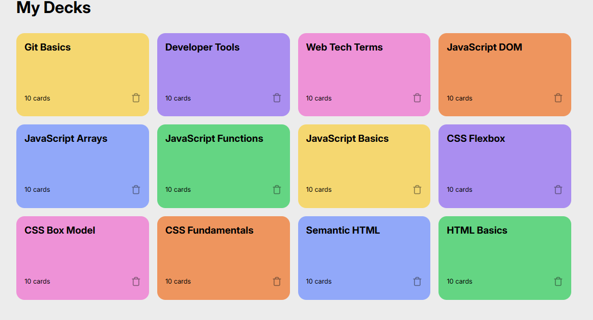

# Flash Cards Project

## Features

A flashcard application that allows users to study information using organized decks of flashcards.

- **Home View:** Displays available flashcard decks.
- **Open Deck View:** Allows users to open a deck, view its flashcards, and practice using the carousel.
- **Flashcard Carousel:** Allows users to flip cards to reveal answers and navigate between flashcards.
- **Confirmation Modal:** Displays a confirmation dialog before deleting a deck or flashcard.
- **Responsive Design:** Adapts the home, deck, and carousel views to smaller screens, including mobile devices.

## Technologies used

HTML, CSS, and JavaScript

## Deployed Site

Check out [this site](https://davistakia1.github.io/ai-se_project_flashcards) on GitHub Pages.

## Project Pitch Video

Check out [my Project Pitch video](https://www.loom.com/share/00993a878c0c4c0fa0cfbead50ccebb8), where I demonstrate Tech In A Flash, explain the technologies I used, and discuss challenges I faced while building the application.
